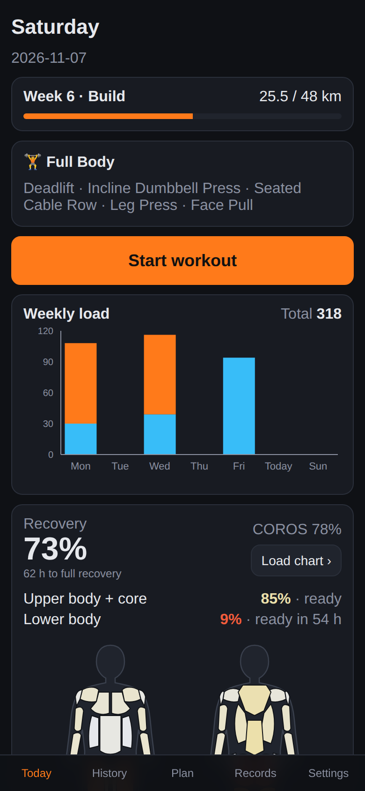
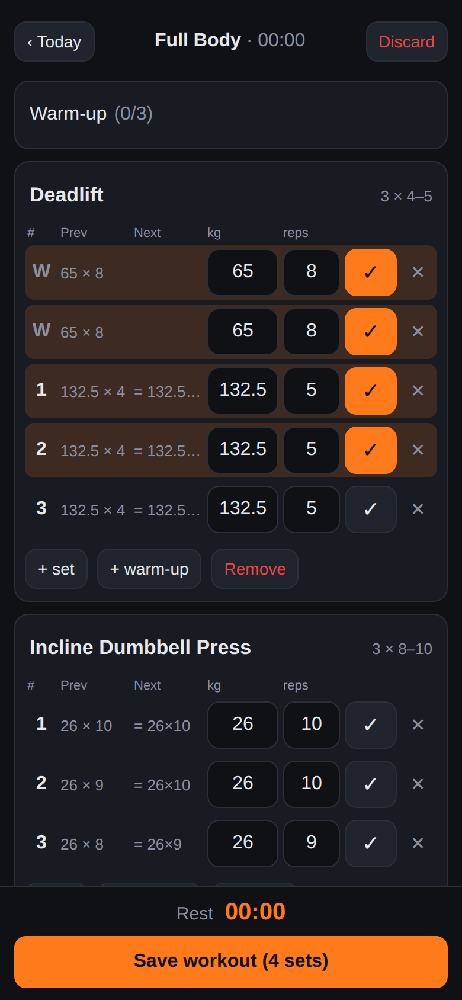
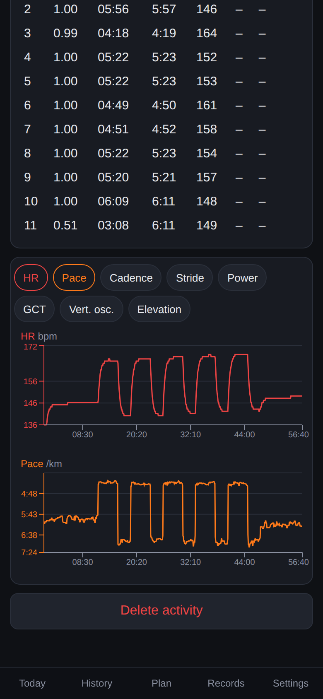
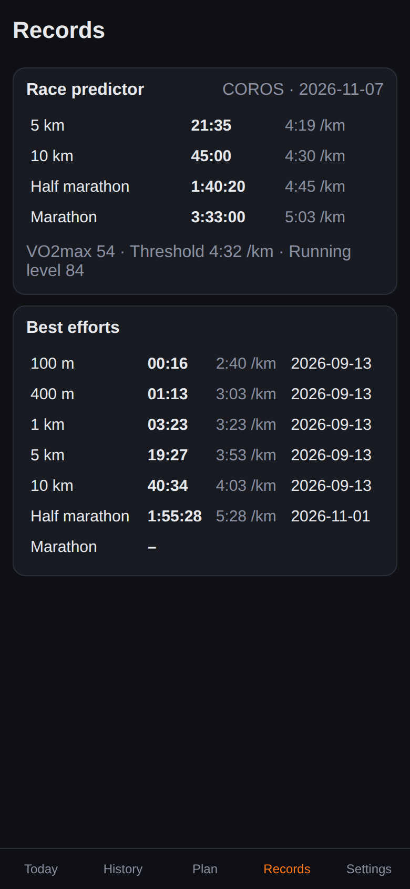

# Hybridly

Self-hosted training tracker for hybrid athletes: strength workouts logged from the phone with load suggestions, running data from COROS, recovery and progress in one place. Single user, runs on a home machine and is reached over Tailscale as a PWA.

<p>
  
  
  
  
</p>

**Stack:** FastAPI · SQLAlchemy 2 · Alembic · PostgreSQL 16 · React + TypeScript (Vite) · nginx · Docker Compose · pytest / Vitest · GitHub Actions.

Website: https://mariuszmackowski.github.io/Hybridly/

## Install

On a Linux machine with Docker and Git:

```bash
curl -fsSL https://raw.githubusercontent.com/MariuszMackowski/Hybridly/main/install.sh | bash
```

It clones into `~/hybridly`, writes `.env` (random DB password, port, timezone), builds and starts the stack, seeds the exercise catalog and optionally adds a systemd unit that starts the app on boot. Re-run it to update.

Manual setup instead:

```bash
cp .env.example .env
docker compose up -d --build        # db, backend (migrates on start), web on :8080
```

Open http://localhost:8080. The app has no login (single user): keep it on your LAN / Tailscale.

## First-time data

Personal files live in `data/` (git-ignored, mounted read-only at `/data`):

```bash
docker compose run --rm backend python -m app.cli seed-exercises
docker compose run --rm backend python -m app.cli import-gravitus /data/<gravitus-export>.csv
```

Both commands are safe to re-run: existing exercises and workouts are skipped.

## Phone access (Tailscale)

On the home machine (once):

```bash
sudo tailscale serve --bg --https=443 http://localhost:8080
tailscale serve status            # shows https://<machine>.<tailnet>.ts.net
```

On the iPhone (Tailscale app connected): open that URL in Safari → Share → **Add to Home Screen**. The app opens full-screen; a workout in progress is kept on the phone until **Save**.

## COROS sync

Settings → **Connect COROS** uses the official COROS MCP server (OAuth with dynamic client registration + PKCE; EU endpoint by default, `COROS_SERVER_URL` to change).

- If the app is reachable over HTTPS (e.g. `tailscale serve`), set `PUBLIC_URL` in `.env` and COROS redirects straight back to `/api/coros/callback`.
- Otherwise the login ends on a `http://localhost:8765/callback?code=…` error page: paste that address into the box in Settings.

Sync runs in the Celery worker: once whenever the stack starts and on **Sync now**. It imports every non-strength activity (FIT file + COROS training load / TE) and stores the daily recovery, training-load and fitness (VO2max, race predictor) snapshots. COROS allows 50 FIT downloads per day, so one run downloads at most 45; the rest follow on the next run. FIT files are kept in `data/fit/`. Runs can also be added by uploading `.fit` files on the History tab — the same activity from both sources is stored once.

## Workout logger

- Start from a template (or empty) on **Today**; the workout is kept on the phone until **Save**. Each set shows the previous result and a **Suggested** weight × reps (double progression, step = the exercise's *increment kg*); tapping a field clears it for a new number.
- **+ Add exercise** has a muscle filter and search. **⋯** on a card: **Replace** (template alternatives and exercises for the same muscles first; the new one takes the same spot), **Super set with…** (an exercise from this workout or a new one; sets alternate A1, B1, A2…) and **Unlink superset**.
- Exercises can list **grips** (e.g. `V-grip, wide`, set in Settings → Exercises). The logger shows them as chips, remembers the last one and keeps Prev/Suggested and PRs separate per grip.

## Progress

- **History** → a workout: volume per muscle (primary muscles count fully, secondary half) and, per exercise, volume (total reps for bodyweight-only work) or best set, with the change against the session closest to 4 weeks earlier. Warm-ups are not counted.
- Exercise page (**Progress** in Settings → Exercises, or tap an exercise in a workout): estimated 1RM and top set over time, weekly volume, a "to beat last time, try …" target, recent sessions, records (best e1RM, heaviest, biggest set, best session) and estimated maxes for 1–12 reps. Grip and range (3 months / 1 year / all) filters.

## Running plan & home routines

- **Plan** tab → *Instructions for your AI coach*: copy the format description, send it to the coach, then import the YAML it returns (file or paste). CLI: `python -m app.cli import-plan /data/seed/<plan>.yaml`.
- **Plan** tab → *Training summary for your AI coach*: pick a date range (default: last 4 weeks) and copy a text summary — current recovery, bodyweight and plan week, a weekly overview (gym sessions, working sets, run km vs. planned), every gym set, runs compared with the plan and missed planned runs.
- A newer plan takes over from `max(its first week, today)`; earlier days keep the plan that was active then. Runs are matched to planned sessions automatically (same day, otherwise ±1 day if the distance is plausible) and compared: distance, pace vs. range, time in HR zone, interval laps.
- **Today** shows the planned run, week progress, this week's daily load (gym + cardio, Mon–Sun, with the week total), coach notes, the strength template planned for the weekday (with a cutback/taper hint), the day's home routines to tick off and the recovery view.
- Exercises are measured in reps, time (s) or distance (m), each with optional kg.
- Exercises, templates, the weekday template plan and home routines live under **Settings → Training setup**. Home routines: today's checklist on top; below, add YouTube links to the library, group them into routines (alternatives — doing one counts) and assign them to weekdays.

## Records

**Records** tab: COROS race predictor (5 km – marathon, VO2max, threshold pace), the bodyweight trend and the fastest 100 m / 400 m / 1 km / 5 km / 10 km / half / marathon segment found in any run (computed from the 1 Hz FIT data, linked to the run). After a parser change run `python -m app.cli reparse-activities` to refill them.

## Load & recovery

- One recovery % for gym and running together (COROS's own % shown alongside). Run load is the COROS training load; strength sets are scaled to the same range by set intensity (set e1RM vs. best e1RM of that exercise), unilateral sets count twice, warm-ups not at all.
- Fatigue decays exponentially (36 h overall, 48 h per muscle); capacity is 3 × the mean daily load of the last 42 days (min. 120). Constants: `backend/app/load/model.py`.
- Upper body + core and lower body get their own recovery % (from the most fatigued muscle of the region) and hours until that muscle drops below 30 %.
- Muscle map (front/back, white → red) with the most fatigued muscles listed; **Show all** expands to the full breakdown. **Load chart** opens the last 14 days of gym vs. cardio load.
- The logger stops suggesting weight increases (holds the weight, marked 💤) while overall recovery is below 40 % or a primary muscle of the exercise is ≥ 70 % fatigued.

## Development

```bash
docker compose run --rm backend pytest -q          # backend tests (uses hybridly_test DB)
docker compose run --rm backend ruff check .
cd frontend && npm install && npm test && npm run typecheck
npm run dev                                         # Vite on :5173, API proxied to :8080
```

## License

MIT — see `LICENSE`.
